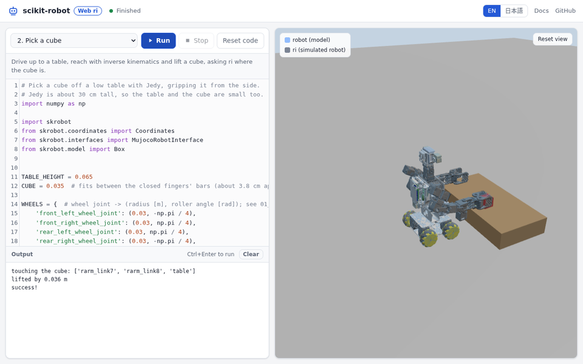

# scikit-robot-web

[English](README.md)

**試す:** https://iory.github.io/scikit-robot-web/?lang=ja

[](https://iory.github.io/scikit-robot-web/?lang=ja)

インストールなしでブラウザからロボットをプログラムできるページです。ページに
Python を書くとその場で動きます。[scikit-robot](https://github.com/iory/scikit-robot)
は [Pyodide](https://pyodide.org/) (WebAssembly 版の Python) の上で動き、
ロボットは [MuJoCo](https://mujoco.org/) の WebAssembly 版でシミュレーション
します。ロボットは JSK の小型双腕移動ロボット Jedy です。サーバは静的な
ファイルを配るだけです。

同じプログラムはデスクトップでも動きます。その場合 scikit-robot の
`MujocoRobotInterface` は `mujoco` パッケージを使います。

## robot と ri

scikit-robot (とその前の EusLisp) で実機を動かすプログラムは、2 つのものを
分けて扱います。

- **`robot`**: 計画に使うロボットの模型。順運動学・逆運動学や干渉チェックに
  使う。書き換えても何も動かない。一瞬で変わり、机もすり抜ける。
- **`ri`**: ロボットインタフェース。ロボットに指令を送り、実際にどうなったかを
  読む。動くには時間がかかり、重力や接触で指令どおりにならないこともある。

「robot で考えて、ri で動かして、ri で確かめる」が基本の流れです。

```python
robot.inverse_kinematics(target, link_list=robot.rarm.link_list,
                         move_target=robot.rarm_end_coords)
ri.angle_vector(robot.angle_vector(), 2.0)  # 送る。2 秒で到達
ri.wait_interpolation()                     # 動き終わるまで待つ
robot.angle_vector(ri.angle_vector())       # 実際の姿勢を読む
```

`ri` は `robot` に書き込みません。ROS のインタフェースと同じく、自分の
コピーを使います。ページの 3D ビューでは、青い半透明が `robot`、ふつうの色が
`ri` の動かすロボットなので、違いが目で見えます。実機向けのプログラムとの
違いは `ri` を作る 1 行だけです。

## サンプル

ページには 4 つのサンプルがあります (`site/samples/ja`、英語版は `site/samples/en`)。

1. **基本**: `ri.angle_vector` で関節角度を送り、`ri.wait_interpolation` で
   待ち、`ri.go_pos` で台車を動かして、状態を読み返す。
2. **箱をつかむ**: 台まで進み、逆運動学で手を伸ばして箱を持ち上げる。箱の
   位置は `ri` から読む。
3. **robot と ri の違い**: 手を机の中に入れる姿勢を送る。模型はすり抜け、
   ロボットは天板で止まる。
4. **ピックで見る robot と ri の違い**: もう一度ピックしながら、計画、台車の
   移動、グリッパーで箱を挟む所、箱の位置で `robot` と `ri` がずれる様子を
   見る。

デスクトップでも動きます (`viewer=True` で MuJoCo のビューアが開きます)。

```sh
pip install scikit-robot[mujoco] coacd
python site/samples/ja/02_pick.py
```

## ri でできること

| 呼び出し | 内容 |
| --- | --- |
| `ri.angle_vector(av, time)` | 関節角度を送る。`time` 秒で到達 (関節の速度上限まで延びる)。すぐに戻る。 |
| `ri.angle_vector_sequence(avs, times)` | 複数の姿勢を止まらずに通る。 |
| `ri.wait_interpolation()` | 最後に送った動作が終わるまで待つ。 |
| `ri.angle_vector()` | 今の関節角度。 |
| `ri.go_pos(x, y, yaw)`、`ri.go_velocity(...)`、`ri.move_to(coords)` | 台車を動かす (`planar_base=True`)。`go_pos` は台車から見た向き。 |
| `ri.odom` | 台車の位置。 |
| `ri.object_coords(name)`、`ri.contacts(name)` | 物体の位置と、触れているもの。 |
| `ri.get_image(camera)`、`ri.get_depth(camera)` | `cameras=` で付けたカメラの画像。 |

`ri.object_coords` と `ri.contacts` はシミュレーションだから取れる正解の
値です。実機ではカメラなどのセンサから推定します。

## 制限

- **停止** は Python を再起動します (約 10 秒)。実行中の Python を割り込みで
  止めるにはクロスオリジン分離のヘッダが要り、GitHub Pages のような静的な
  ホスティングでは出せないためです。
- 最初の実行ではロボットの変換に数秒かかります。
- シミュレーションの時間は `ri` の呼び出しの中 (`wait_interpolation`、
  `go_pos` など) でだけ進みます。`time.sleep` ではロボットは動かず、
  `ri.is_interpolating()` を待つループは終わりません。
- カメラ画像は three.js で描くので、色や陰影は MuJoCo 本体の描画と違います。
- 動作確認は Chrome で行いました。

ページの作り方と仕組みは [英語の README](README.md#building-and-serving) に
あります。
